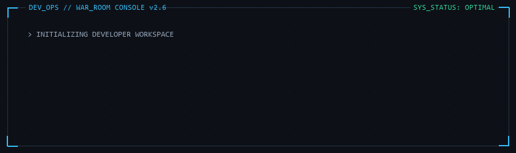
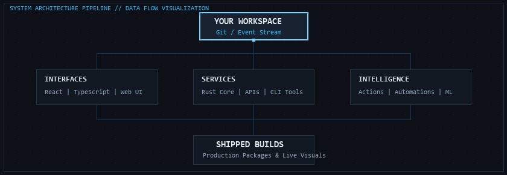

<div align="center">
  
</div>

<p align="center">
  <code><a href="#mission-dossiers">[ EXPLORE BUILDS ]</a></code> &nbsp;
  <code><a href="#system-architecture">[ ARCHITECTURE ]</a></code> &nbsp;
  <code><a href="#engineering-pipeline">[ PIPELINE ]</a></code> &nbsp;
  <code><a href="#command-link">[ SECURE CONTACT ]</a></code>
</p>

```
OPERATOR: ANMOL JAIN
ROLE: SYSTEMS ENGINEERING & FULL-CYCLE DEVELOPMENT
BASE: GLOBAL // TERMINAL ACCESS: GRANTED
STATUS: SYSTEM OPTIMAL // READY FOR ENGAGEMENTS
```

---

### MISSION DOSSIERS

```
┌─ MISSION 001 ────────────────────────────────────────────────────────┐
│ SYSTEM:    GIT KOI                                                   │
│ CLASSIF:   ACTIVITY-DRIVEN PIXEL ART SYNTHESIS & AUTOMATION ENGINE   │
│ OBJECTIVE: Synthesize public contributions into living pixel-art koi │
│ STACK:     Rust | GitHub Actions Composite | WebAssembly             │
│ STATUS:    OPERATIONAL / PRODUCTION DEPLOYED                         │
└──────────────────────────────────────────────────────────────────────┘
```

<div align="center">
  <p><strong>[ LIVE APPLICATION TELEMETRY & RUNTIME PREVIEW ]</strong></p>
  
  <p>
    <em>Dynamic activity koi: redrawn nightly via automated GitHub Actions runner. Contributor streak dictates swim physics; codebase languages determine pigment palette.</em>
  </p>
  <p>
    <code><a href="https://github.com/yalongwastaken/git-koi">[ SOURCE ENGINE ]</a></code> &nbsp;
    <code><a href=".github/workflows/koi.yml">[ AUTOMATION WORKFLOW ]</a></code> &nbsp;
    <code><a href="https://docs.rs/git-koi">[ API SPECIFICATION ]</a></code>
  </p>
</div>

<br>

```
┌─ MISSION 002 ────────────────────────────────────────────────────────┐
│ SYSTEM:    TRAINEE IQ                                                │
│ CLASSIF:   AI-ASSISTED TRAINING & PERFORMANCE DIAGNOSTICS PLATFORM   │
│ OBJECTIVE: Identify engineering skill gaps and automate review loops │
│ STACK:     TypeScript | Python | Next.js | Analytical ML Engine      │
│ STATUS:    ACTIVE ARCHITECTURE / PROTOTYPE                           │
└──────────────────────────────────────────────────────────────────────┘
```

```
TELEMETRY LOGS:
• Ingests developer submissions and repository pull requests in real time.
• Evaluates architectural consistency against production checklists.
• Generates tailored skill trajectories and automated remediation modules.

[ REPOSITORY COMING SOON ] • [ ARCHITECTURE REVIEW: PENDING ]
```

---

### SYSTEM ARCHITECTURE

<div align="center">
  
</div>

```
YOUR WORKSPACE
      │
┌─────┴───────────────────┬─────────────────────────┐
▼                         ▼                         ▼
INTERFACES                SERVICES                  INTELLIGENCE
React / Next.js / TS      Rust Core / REST APIs     GitHub Actions / ML
Modular UI consoles       Low-latency compute       Automation & workflows
└─────┬───────────────────┴─────────────────────────┘
      ▼
SHIPPED BUILDS (Production Binaries, Live Profiles, Automated Workflows)
```

---

### ENGINEERING PIPELINE

```
PHASE 01: SPECIFICATION  ──► Threat modeling, constraint mapping, and interface wireframes
PHASE 02: ARCHITECTURE   ──► Schema definition, modular service boundaries, and state contracts
PHASE 03: CORE SYNTHESIS ──► Low-overhead implementation in Rust, TypeScript, and modern toolchains
PHASE 04: VERIFICATION   ──► Automated regression test suites, type validation, and CI checks
PHASE 05: DEPLOYMENT     ──► Declarative GitHub Actions, containerized delivery, and live monitoring
```

---

### COMMAND LINK

```
┌─ TRANSMISSION INTERFACE ─────────────────────────────────────────────┐
│ GITHUB:        https://github.com/Anmol-Jain371                      │
│ DIRECT MAIL:   mailto:anmoljain277353@gmail.com                      │
│ COLLABORATION: Open for systems programming, tooling & web engines   │
└──────────────────────────────────────────────────────────────────────┘
```
