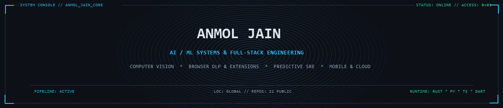
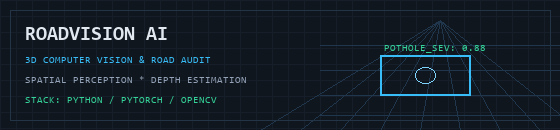
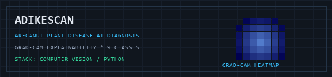
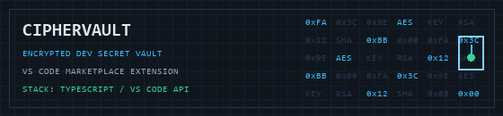
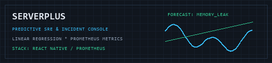

  
    
  

 

<table>
  <tr>
    <td valign="middle">
      <h2>Hey, I'm Anmol Jain</h2>
      
<strong>AI / ML Engineer & Full-Stack Developer</strong>

      

        Building computer vision perception systems, privacy-first developer tooling,
        and scalable full-stack applications.
      

      

        <a href="https://github.com/Anmol-Jain371?tab=repositories"><code>Repositories</code></a> &bull;
        <a href="https://marketplace.visualstudio.com/items?itemName=AnmolJainp.personal-vault"><code>VS Code Extension</code></a> &bull;
        <a href="mailto:anmoljain277353@gmail.com"><code>anmoljain277353@gmail.com</code></a>
      

    </td>
    <td align="center" valign="middle" width="260">
      
       
      <em>Live Activity Koi &bull; updated nightly via GitHub Actions</em>
    </td>
  </tr>
</table>

### Machine Learning & Computer Vision

<table>
  <tr>
    <td width="50%" valign="top">
      
      <h3><a href="https://github.com/Anmol-Jain371/Deep_Learning_project---POTHOLEdetection">RoadVision AI</a></h3>
      
<strong>Real-Time 3D Pothole Perception & Road Audit</strong>

      
Computer vision system for municipal road surface inspection. Performs real-time spatial perception, depth estimation, and 3D damage classification.

      
<code>Python</code> <code>PyTorch</code> <code>OpenCV</code> <code>Computer Vision</code>

    </td>
    <td width="50%" valign="top">
      
      <h3><a href="https://github.com/Anmol-Jain371/YLD">AdikeScan</a></h3>
      
<strong>Arecanut Plant Disease AI Diagnosis</strong>

      
Plant pathology diagnostic platform classifying 9 distinct Arecanut palm disease classes with Grad-CAM visual explainability overlays and quantitative damage scoring.

      
<code>Python</code> <code>Deep Learning</code> <code>Grad-CAM</code> <code>Web</code>

    </td>
  </tr>
  <tr>
    <td width="50%" valign="top">
      <h3><a href="https://github.com/Anmol-Jain371/recruit-genesis-ai">Recruit Genesis AI</a></h3>
      
<strong>Candidate Resume Ranking Engine</strong>

      
Automated recruitment pipeline analyzing candidate resumes against job descriptions through structural competency parsing and relevance scoring.

      
<code>TypeScript</code> <code>NLP</code> <code>Next.js</code>

    </td>
    <td width="50%" valign="top">
      
      <h3><a href="https://github.com/Anmol-Jain371/CipherVault">CipherVault</a></h3>
      
<strong>Encrypted Developer Secret & Key Vault</strong>

      
Published extension on the VS Code Marketplace (<code>personal-vault</code>). Provides local encrypted storage and instant access for API tokens and credentials inside the IDE.

      
<code>TypeScript</code> <code>VS Code API</code> <code>Security</code>

    </td>
  </tr>
</table>

### Systems, Full-Stack & Tooling

<table>
  <tr>
    <td width="50%" valign="top">
      
      <h3><a href="https://github.com/Anmol-Jain371/ServerPLUS">ServerPlus</a></h3>
      
<strong>SRE Predictive Failure & Incident Console</strong>

      
Predictive failure monitoring system using linear regression time-series forecasting for memory exhaustion, paired with Prometheus metrics and a React Native mobile console.

      
<code>React Native</code> <code>Python</code> <code>Prometheus</code> <code>DevOps</code>

    </td>
    <td width="50%" valign="top">
      <h3><a href="https://github.com/Anmol-Jain371/Sentinal-The-Ai-filter-extension">SentinelX</a></h3>
      
<strong>Browser Data Loss Prevention (DLP) for AI</strong>

      
Client-side privacy-preserving Chrome extension monitoring outbound web payloads to prevent unauthorized sensitive data exfiltration to AI services.

      
<code>JavaScript</code> <code>Chrome API</code> <code>Security</code>

    </td>
  </tr>
  <tr>
    <td width="50%" valign="top">
      <h3><a href="https://github.com/Anmol-Jain371/Rent_analyser_for_mom">Rent & Utility Manager</a></h3>
      
<strong>Rental Property & Expense Analytics</strong>

      
Cross-platform mobile application handling tenant records, dynamic utility split calculations, financial analytics charts, and automated PDF invoice generation.

      
<code>Dart</code> <code>Flutter</code> <code>Mobile</code>

    </td>
    <td width="50%" valign="top">
      <h3></h3>
      
<strong>Student Cross-Disciplinary Project Platform</strong>

      
Matchmaking and project coordination workspace enabling university students across departments to build teams, track milestones, and share assets.

      
<code>JavaScript</code> <code>React</code> <code>Node.js</code>

    </td>
  </tr>
</table>

### Technical Arsenal

| Domain | Technologies & Tooling |
| :--- | :--- |
| **Languages** | Python, TypeScript, JavaScript, Dart, Java, SQL, Rust |
| **AI / Machine Learning** | PyTorch, TensorFlow, OpenCV, Grad-CAM, Scikit-learn, Pandas, NumPy |
| **Full-Stack & Mobile** | React, Next.js, React Native, Flutter, Node.js, Express, Vite, REST APIs |
| **DevOps & Infrastructure** | Docker, GitHub Actions, Prometheus, Linux, Git |
