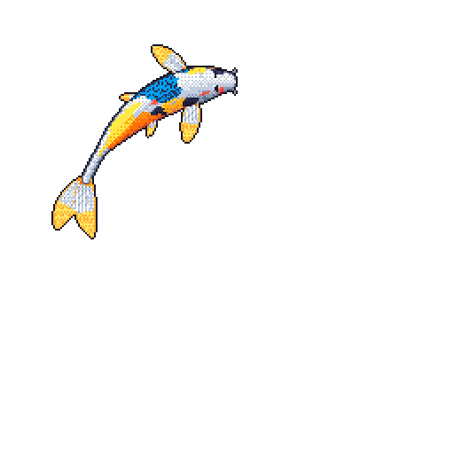

# Hey guys, I’m Anmol Jain — really glad to meet you all! 👋

  
  

    <em>🐟 <strong>My Activity Koi:</strong> Fed by commits, colored by languages, and animated nightly by GitHub Actions!</em>
  

---

### 🚀 About Me
- 💻 Passionate developer building exciting software and exploring new technologies.
- 🛠️ Interested in open source, workflow automation, and building impactful projects.
- 🤝 Always excited to collaborate and connect with fellow developers.

---

### 🎏 Featured Project: [Git Koi](https://github.com/yalongwastaken/git-koi)
> Git Koi transforms GitHub contribution activity into a living, animated pixel-art koi fish directly on the profile README.

- 🎨 **Languages color it** according to repository languages.
- 📈 **Contributions grow it** over time.
- 🌊 **Recent activity** influences how it swims.
- ⚡ **Automated nightly** using a scheduled GitHub Actions workflow.

---

### 📫 Connect With Me
- 🐙 **GitHub:** [@Anmol-Jain371](https://github.com/Anmol-Jain371)
- ✉️ **Email:** [anmoljain277353@gmail.com](mailto:anmoljain277353@gmail.com)
